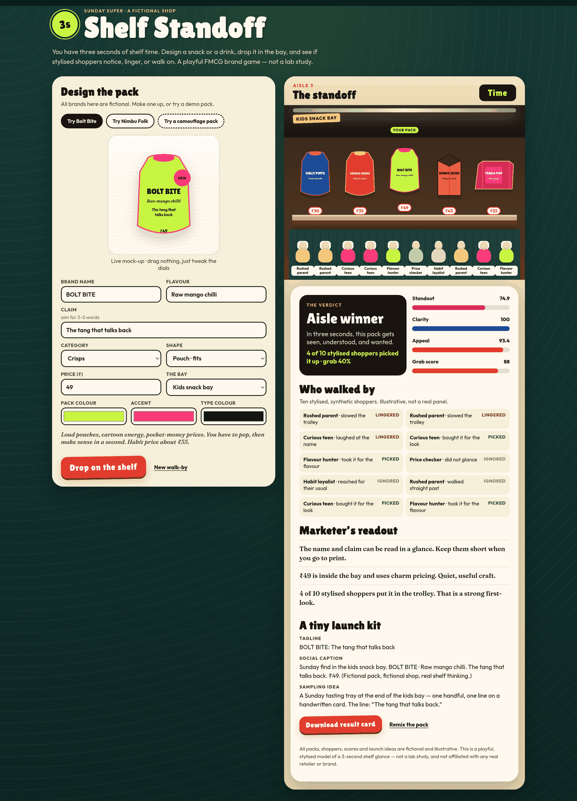

# Shelf Standoff

**You have three seconds of shelf time. Win the aisle.**

An in-browser FMCG brand game: design a fictional snack or drink pack (colour, name, flavour, claim, shape, price), drop it into a supermarket bay against other fictional packs, and watch stylised shoppers react in three seconds. You get scored on **standout**, **clarity** and **appeal**, plus a marketer’s readout, a tiny launch kit (tagline, social caption, sampling idea) and a downloadable result card.

[Live demo](https://yashsarkar1806-creator.github.io/shelf-standoff/?demo=1)



Sunday Super, the rival packs and the ten shoppers are all fictional. The scores are a playful, stylised model of a three-second first look at the shelf — illustrative, not a lab study, and not affiliated with any real retailer or brand.

## Why it exists

FMCG marketers often talk about a brief “first moment of truth” at the shelf: if a new pack cannot be seen, read and wanted in a glance, the hand goes back to a habit product. This game turns that idea into something you can play with. It is a brand-craft exercise, not an analytics dashboard.

Designed for a brand or product-marketing portfolio. Built as a static site, no account and no paid APIs.

## What you can do

- Design a pack with a live SVG mock-up: pouch, can, bottle, carton or bar.
- Place it in one of four bays: kids snack bay, cold drinks door, impulse till, or the healthy-ish aisle. Each bay has its own habit price and fictional neighbours.
- Try three demo packs: **Bolt Bite** (a loud mango-chilli pouch), **Nimbu Folk** (a salted-lime can), and a deliberately bad **camouflage** pack.
- Watch a three-second walk-by. Ten stylised shoppers (rushed parent, flavour hunter, price checker, habit loyalist, curious teen) notice, linger, pick up — or walk on.
- Read a marketer’s verdict on colour contrast, claim length, type contrast, price vs the bay, and category fit.
- Leave with a tagline, a social caption and a sampling idea, and download a PNG result card.

Add `?demo=1` to the URL to auto-run Bolt Bite.

## How the scores work

All maths lives in `score.js` and is covered by unit tests. Each score is 0–100.

- **Standout (40% of the grab score).** Colour distance from neighbouring packs, a “me-too” penalty when you sit on a rival’s hue, silhouette uniqueness, and a little credit for a contrasting accent colour.
- **Clarity (30%).** Name length and word count, a 3–5 word sweet spot for the claim, WCAG-style contrast between type and pack colour, and a penalty for empty words such as “premium” or “best”.
- **Appeal (30%).** Price against the bay’s band and habit price (with a small charm-pricing bump at ₹x9), flavour vividness, a concrete claim, and whether the category belongs in that bay.

Shopper actions are a seeded probability walk, so the same pack and seed replay the same walk-by. A “New walk-by” button draws a fresh seed. Nothing here is a forecast of real sales.

## Run locally

```bash
python3 -m http.server 8000   # then open http://localhost:8000/?demo=1
npm test                      # 26 unit tests for the scoring and shopper model (Node 18+)
```

## Files

- `score.js`: pure scoring, rival shelves, shopper simulation, readout and launch kit. Works in the browser or Node.
- `app.js`, `index.html`, `styles.css`: pack designer, aisle animation and share-card canvas.
- `test/score.test.js`: unit tests.

## Licence

MIT, see `LICENSE`.

A portfolio project by Yash Sarkar, Master of Marketing (UWA).
